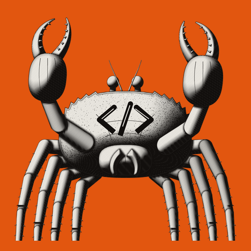

<p align="center">
  
</p>

<h1 align="center">rust-anything</h1>

<p align="center"><b>Қолданбаңызды Rust тілінде қайта жазып, оның бұрынғыдай жұмыс істейтінін дәлелдеңіз.</b></p>

<p align="center">2.0 нұсқасындағы жаңалық: <a href="real-world.md#prettier">Prettier, Rust-қа портталды</a>. 19x жылдамырақ · 17,224 жазылған іске қосудың 15,837-сі толығымен Rust-та · барлығы байтпа-байт бірдей</p>

<p align="center">
  <a href="https://crates.io/crates/rust-anything"></a>
  <a href="https://www.npmjs.com/package/rust-anything"></a>
  <a href="https://github.com/erkamyaman/rust-anything/actions/workflows/ci.yml"></a>
  <a href="https://github.com/erkamyaman/rust-anything"></a>
  <a href="https://github.com/AIshihzong/awesome-reverse-engineer-anything"></a>
</p>

<p align="center">
  <a href="#жылдам-бастау">Жылдам бастау</a> ·
  <a href="#тілдер">Тілдер</a> ·
  <a href="real-world.md">Нақты порттар</a> ·
  <a href="how-it-works.md#how-it-works">Қалай жұмыс істейді</a> ·
  <a href="whole-apps.md#port-a-whole-app">Бүкіл қолданбалар</a> ·
  <a href="faq.md#faq">Жиі қойылатын сұрақтар</a>
</p>

<p align="center">Түркияда 🇹🇷 <a href="https://github.com/erkamyaman">erKam Yaman</a> жасаған · <a href="../LICENSE">MIT</a> · <a href="https://github.com/sponsors/erkamyaman">❤️ Маған демеуші болыңыз</a></p>

<p align="center">Демеуші: <a href="https://coderabbit.ai"> <b>CodeRabbit</b></a></p>

<p align="center"><sub><a href="../README.md">English</a> · <a href="README_TR.md">Türkçe</a> · <a href="README_UK.md">Українська</a> · <a href="README_ZH.md">简体中文</a> · <a href="README_ZH-TW.md">繁體中文</a> · <a href="README_DE.md">Deutsch</a> · <a href="README_FR.md">Français</a> · <a href="README_RU.md">Русский</a> · <a href="README_JA.md">日本語</a> · <a href="README_KO.md">한국어</a> · <a href="README_AZ.md">Azərbaycanca</a> · <a href="README_UZ.md">Oʻzbekcha</a> · Қазақша · <a href="README_KY.md">Кыргызча</a> · <a href="README_TK.md">Türkmençe</a> · <a href="README_TT.md">Татарча</a> · <a href="README_UG.md">ئۇيغۇرچە</a> · <a href="README_PT.md">Português</a> · <a href="README_VI.md">Tiếng Việt</a></sub></p>
<p align="center"><sub>Бұл аударманы қауымдастық жүргізеді, сондықтан ол <a href="../README.md">ағылшынша README</a> нұсқасынан артта қалуы мүмкін.</sub></p>

<table>
  <tr>
    <td width="25%" valign="top">
      <b>Жазып алу</b><br>
      <code>record</code> түпнұсқаны генерацияланған шеткі кейстерде, семантикалық тұзақтарда және өз кірістеріңізде іске қосып, оның не қайтаратынын немесе не лақтыратынын сақтайды.
    </td>
    <td width="25%" valign="top">
      <b>Порттау</b><br>
      <code>bridge</code> Rust crate-ін және wrapper-ді генерациялайды, сондықтан шақырушылар түпнұсқа API-ді сақтайды. Rust кодын сіз немесе агентіңіз жазады.
    </td>
    <td width="25%" valign="top">
      <b>Тексеру</b><br>
      <code>diff</code> әр жазылған кейсті Rust-қа қарсы қайта ойнатады, және барлығы сәйкес келіп, <code>gate</code> өтпейінше ештеңе шығарылмайды.
    </td>
    <td width="25%" valign="top">
      <b>Lift</b><br>
      Қайта ойнату fallback-сіз өтіп, әр бірлік gate-тен өткенде, <code>app lift</code> оны таза Rust қолданбасына айналдырады. Түпнұсқаға ешқашан қол тигізілмейді.
    </td>
  </tr>
</table>

**Бүкіл қолданбаңызды Rust тілінде бөлік-бөлігімен қайта жазыңыз.** rust-anything сіздің Node.js
(TypeScript/JavaScript), Python, C, Go, Ruby немесе Java қолданбаңыздың бүгін не істейтінін жазып
алады, содан кейін Rust нұсқасының әр бөлігін келесіге өтпес бұрын сол жазбамен салыстырып тексереді,
қолданба толығымен таза Rust болғанша. CLI-лар, HTTP серверлер және кітапханалар; Rust кодын сіздің
кодинг-агентіңіз (немесе өзіңіз) жазады. Ол тек жазба қамтитын нәрсені ғана ұстай алады:
[Ол нені ұстай алмайды](how-it-works.md#what-it-cant-catch) бөлімін қараңыз. Бүкіл құралдар мен
серверлер немесе тек баяу бөлік, бір уақытта бір hot path:

| Нақты жоба, шығысы түпнұсқамен бірдей | Түпнұсқа | rust-anything-пен |
| --- | ---: | ---: |
| [Prettier](real-world.md#prettier) 3.6.2, командалық жолдан 2,360 JS/TS файл | 128.6 s | **6.9 s: 19x жылдамырақ** |
| Prettier, командалық жолдан 6,305 Markdown файл | 352 s | **22.5 s: 15.6x жылдамырақ** |
| [json-server](real-world.md#json-server), бүкіл Node сервер: бос тұрғандағы жад | 74 MB | **3.5 MB**, бір 5.3 MB бинарлық файл |
| json-server, іске қосудан бірінші жауапқа дейін | 79 бен 85 ms аралығы | **8 бен 10 ms аралығы** |
| [Fuse.js](real-world.md#fusejs) арқылы 50,000 жол бойынша іздеу, бір сұранысқа | 91.2 ms | **2.8 ms: 32x жылдамырақ** |

Prettier: 17,224 жазылған іске қосудың ішінен 15,837 іске қосу 10 тілде (JavaScript, TypeScript, JSX,
JSON, GraphQL, YAML, Markdown, CSS, SCSS, Less) толығымен Rust ішінде пішімделеді, ал барлық 17,224
іске қосу Prettier-мен байтпа-байт сәйкес келеді, өйткені әлі портталмаған кез келген нәрсе Prettier-ге
қайтарылады (fallback). json-server: жазылған 514/514 HTTP кейсі таза Rust бинарлық файлында сәйкес
келеді. Apple M4-те өлшенді, әрқайсысы екі рет іске қосылды, әр шығыс уақыт өлшенбес бұрын
салыстырылды ([толығырақ](real-world.md)). Әр кішкентай функция үшін Rust-ты жеке-жеке шақыру әдетте
JIT-тен *баяуырақ*; rust-anything көшіруге тұрарлық циклды тауып, соны көшіреді.

<p align="center">
  
  <br>
  <sub>ms, Fuse.js және json-server жобаларынан алынған 59 нақты файлда Prettier мен оның Rust порты (Apple M4). Шығысы байтпа-байт бірдей. <a href="real-world.md#prettier">Қалай өлшенді</a>.</sub>
</p>

<p align="center">
  
  <br>
  <sub>json-server, бүкіл Node сервері, таза Rust бинарлық файлына айналдырылды (Apple M4). <a href="real-world.md#json-server">Қалай өлшенді</a>.</sub>
</p>

> rust-anything тәуелсіз жоба, ол Rust Project немесе Rust Foundation ұйымдарымен байланысты емес
> және олар тарапынан мақұлданбаған. «Rust» Rust Foundation ұйымының сауда белгісі.

> [!WARNING]
> `record` және `app record` түпнұсқа кодыңызды іске қосады: әр функцияны (немесе бүкіл қолданбаны)
> көптеген генерацияланған кірістермен шақырады, ал `app record` әр кейсті екі рет іске қосады. `diff`,
> `gate` және `app replay` сол кейстерді портта немесе түпнұсқада қайта іске қосады. Файлдарға жазатын,
> дерекқормен жұмыс істейтін немесе желіге қатынайтын код мұны әр кейс үшін бір рет істейді. Оларды
> жобаның көшірмесінде, тесттік дерекқормен және ортада production тіркелгі деректері жоқ күйде іске қосыңыз.

## Жылдам бастау

Мынаны Claude Code, Codex, Cursor, Gemini CLI немесе OpenCode ішіне қойып, орнатуды агентіңізге тапсырыңыз:

```text
Install rust-anything: run `cargo install rust-anything`, then `rust-anything setup`.
Tell me when to restart you.
```

Немесе өзіңіз:

```sh
cargo install rust-anything   # from crates.io
rust-anything setup           # registers it with Claude Code, Codex, Cursor, Gemini CLI and OpenCode
```

Rust toolchain әлі жоқ па? macOS, Linux және Windows үшін дайын бинарлық файлдар әр
[GitHub release](https://github.com/erkamyaman/rust-anything/releases) бетіне тіркелген, ал JavaScript
жобалары үшін `npm install -g rust-anything` сол бинарлық файлды орнатады.

Claude Code ішінде оны плагин ретінде де орнатуға болады (MCP сервер және skill; жоғарыдағы CLI сіздің
`PATH` ішінде болуы керек):

```text
/plugin install rust-anything --marketplace erkamyaman/rust-anything
```

`setup` тапқан әр агентке MCP серверді қосады және workflow skill-ін агент skill-дерді оқитын жерге
орнатады. Ол басқа баптауларыңызды сақтайды, оны қайта іске қосу қауіпсіз, ал `--remove` барлығын кері
қайтарады. Содан кейін агентіңізден, мысалы, былай сұраңыз:

- *"Осы CLI-ды rust-anything көмегімен басынан аяғына дейін Rust тілінде қайта жаз және оның дәл солай жұмыс істейтінін дәлелде."*
- *"Бұл іздеу баяу сияқты. Оны rust-anything көмегімен профайлда және hot loop-ты Rust-қа көшір."*
- *"rust-anything көмегімен `src/parser/` бумасын Rust-қа көшіру жоспарын жаса; бірінші бірлікті порттап, дәлелде."*
- *"`rust/text-rs` ішіндегі Rust портын түпнұсқамен бенчмарк арқылы салыстыр да, оны шығару керек пе, айт."*

### Үйлесімді агенттер

| Агент | `rust-anything setup` қосатыны |
| --- | --- |
| Claude Code | `~/.claude.json` ішінде MCP сервер, `~/.claude/skills/` ішінде skill |
| Codex | `~/.codex/config.toml` ішінде MCP сервер, `~/.codex/skills/` ішінде skill |
| Cursor | `~/.cursor/mcp.json` ішінде MCP сервер |
| Gemini CLI | `~/.gemini/settings.json` ішінде MCP сервер |
| OpenCode | `~/.config/opencode/opencode.json` ішінде MCP сервер (`mcp.servers`), `~/.config/opencode/skills/` ішінде skill |
| Кез келген басқа MCP клиент | `rust-anything mcp` командасын stdio сервер ретінде қолмен қосыңыз ([Орнату](install.md#install) бөлімін қараңыз) |

Бар файлды өзгертпес бұрын `setup` оның көшірмесін қасына сақтайды (`<file>.rust-anything.bak`).

OpenCode-ты қолмен қосу үшін серверді `~/.config/opencode/opencode.json` ішіне қойыңыз (`command`
бүкіл argv болып табылады) және [`skills/rust-anything/`](../skills/rust-anything) бумасын
`~/.config/opencode/skills/rust-anything/` ішіне көшіріңіз:

```json
{
  "mcp": {
    "servers": {
      "rust-anything": { "type": "local", "command": ["rust-anything", "mcp"] }
    }
  }
}
```

Немесе қадамдарды өзіңіз орындаңыз:

```sh
rust-anything profile . -- node bench.mjs              # what is hot, and who calls it
rust-anything bridge . src/fuzzy.ts --batch fuzzyScore:text
# write src/port.rs (or let your agent), then:
rust-anything record rust/fuzzy-rs && rust-anything build rust/fuzzy-rs
rust-anything diff rust/fuzzy-rs                       # every recorded case must match
rust-anything bench rust/fuzzy-rs                      # faster? the verdict says
rust-anything gate rust/fuzzy-rs                       # done means this passes
```

rust-anything кодты аудармайды: Rust кодын сіздің кодинг-агентіңіз (Claude Code, Codex, Cursor, OpenCode, ...)
немесе өзіңіз жазасыз. rust-anything агент сенімді түрде болжай алмайтын нәрселерді береді: уақыт қайда
кетеді, алдымен нені және қандай ретпен порттау керек, қалған код Rust-ты API-ін өзгертпей шақыруы үшін
bridge, порт сәйкес келуге тиіс нақты мінез-құлық, оны шығарудың қауіпсіз жолы және порттың қашан дайын
болғанын айтатын gate.

Бірдей шығыс жеткіліксіз. Қолданбаның сыртқа не жіберетінін де жазып алыңыз, сонда хатты екі рет
жіберетін қайта жазылған нұсқа сәтсіз аяқталады:

<p align="center">
  
  <br>
  <sub><code>app record --effects</code> және <code>app replay</code> командаларының нақты іске қосылуы. <a href="whole-apps.md#side-effects-email-webhooks-and-databases">Жанама әсерлер</a> бөлімін қараңыз.</sub>
</p>

## Тілдер

| Тіл | Бірлік | Bridge | Жазып алатын және қайта ойнататын |
| --- | --- | --- | --- |
| TypeScript/JavaScript | бума немесе файл | генерацияланған бинарлық wire бар napi-rs немесе wasm-bindgen; кластар мен async те бар | Node, `.ts` бастапқы файлдарын тікелей іске қосады |
| Python | пакет немесе модуль | PyO3 (abi3), тікелей түрлендіру, типтелген exception-дар | Python, түпнұсқаны импорттайды |
| C | `.c` файлы | түпнұсқа атаулары мен header бар `extern "C"` функциялары | shared library ретінде компиляцияланған түпнұсқа, ctypes арқылы шақырылады, әр кейске бір fork |
| Go | пакет | типтелген cgo шақырулары және генерацияланған бинарлық wire, түпнұсқа API бар пакетте | генерацияланған Go драйвері, жеке модуль ретінде құрастырылады |
| Ruby | модуль функцияларынан тұратын файл немесе бума | түпнұсқа модульдер астындағы magnus кеңейтімі | генерацияланған Ruby драйвері |
| Java | `public static` әдістерінен тұратын пакет | типтелген JNI және генерацияланған бинарлық wire, түпнұсқа әдістері бар wrapper кластарында | генерацияланған reflection драйвері |
| PHP | функциялар мен `public static` әдістерінен тұратын бума | келесі кезекте: C ABI арқылы PHP FFI | бүгін бүкіл қолданбалар: `app record`, `app replay` және front door, CLI-лар мен серверлер үшін (`php -S`) |
| C# | `public static` әдістерінен тұратын бума | келесі кезекте: C ABI арқылы P/Invoke | бүгін бүкіл қолданбалар: `app record`, `app replay` және front door, CLI-лар мен ASP.NET серверлері үшін (`dotnet <app>.dll`) |

C-дан басқа әр тіл batch кластарын да алады (`--batch`): элементтер шекарадан бір рет өтіп, Rust ішінде
қалады, ал әр шақыру олардың барлығын барлық ядроларда өңдейді.

Тіл репозиторийден анықталады (`go.mod`, `pom.xml`, `.csproj` немесе `.sln`, `pyproject.toml`,
`Gemfile`, `composer.json`, `package.json`, әйтпесе ең көп кездесетін бастапқы файлдар бойынша);
`--lang` оны қолмен көрсетеді. Типтер бастапқы кодтан алынады: TS типтері, Python hint-тері, C, Go, Java
және C# сигнатуралары, Ruby YARD тегтері, PHP типтері және phpdoc; сан ретінде қолданылатын типсіз
параметрлер сан деп есептеледі.

PHP үшін `analyze` PHP қолданбасын жоспарлайды (Composer пакеттері және PSR-4 autoloading,
loose comparison және integer-дің float-қа толып кетуі сияқты тәуекелдер, crate-терге сәйкестендірілген
Composer пакеттері), ал PHP CLI немесе серверін жазып алуға, қайта ойнатуға және Rust front door-ының
артына қоюға болады. Оның бірліктерін PHP FFI арқылы Rust-қа порттау келесі қадам
([issue #2](https://github.com/erkamyaman/rust-anything/issues/2)).

C# та дәл солай жұмыс істейді: `analyze` `.csproj` жобалары мен олардың NuGet пакеттерін оқиды
(crate-терге сәйкестендіріледі), `using` директиваларын бумаларға шешеді және C# басқаша істейтін
нәрселерді белгілейді (`decimal`, `dynamic`, LINQ-тің кейінге қалдырылған сұраныстары, `Task`, `lock`,
reflection). C# CLI немесе ASP.NET серверін жазып алуға, қайта ойнатуға және Rust front door-ының
артына қоюға болады; бірліктерді P/Invoke арқылы порттау келесі кезекте.

## Толығырақ

- [Қалай жұмыс істейді](how-it-works.md): цикл, `bridge` пен `analyze` нені шешеді, hot path-тар, ол нені ұстай алмайды, нақты порт нені талап етеді және түпнұсқадағы өзгерістерден қалмау (`map`)
- [Бүкіл қолданбаны порттау](whole-apps.md): серверлер, CLI-лар мен кітапханалар, front door-дан `app lift`-ке дейін
- [Мысалдар мен тәжірибелер](examples.md): x18n және алты тілдегі нақты код
- [Нақты порттар](real-world.md): json-server, Fuse.js, vercel/ms, бенчмарктарымен
- [Орнату, жаңарту және әзірлеу](install.md): орнатудың барлық тәсілдері, Windows және бастапқы кодтан құрастыру
- [Жиі қойылатын сұрақтар](faq.md) · [Күйі](STATUS.md) · [MCP құралдары](tools.md)

## Демеушілер

<p align="center">
  <a href="https://github.com/erkamyaman/rust-anything">rust-anything</a> тегін және ашық бастапқы кодты жоба. Егер ол жұмысыңызға көмектессе, оған демеуші болуды қарастырыңыз.<br>
  Сіздің қолдауыңыз әзірлеуді жалғастыруға мүмкіндік береді.
</p>

<p align="center">
  <a href="https://coderabbit.ai">
    <picture>
      <source media="(prefers-color-scheme: dark)" srcset="assets/sponsors/company-dark.svg">
      
    </picture>
  </a>
</p>

<p align="center">
  <a href="https://github.com/sponsors/erkamyaman">
    <picture>
      <source media="(prefers-color-scheme: dark)" srcset="assets/sponsors/sponsors-dark.svg">
      
    </picture>
  </a>
</p>

<p align="center">
  <a href="https://github.com/sponsors/erkamyaman"></a>
</p>

## Үлес қосу

Issue-лер мен pull request-тер құпталады; [CONTRIBUTING.md](../CONTRIBUTING.md) ортаны баптауды,
тесттердің қайда орналасатынын және жаңа тілді қалай қосуды түсіндіреді. Дизайн шешімдері және олардың
себептері [DECISIONS.md](../DECISIONS.md) ішінде. Нақты порттардың тәжірибелік мысалдары әсіресе
құпталады. Қауіпсіздік мәселелері туралы жеке хабарлаңыз ([SECURITY.md](../SECURITY.md)), сондай-ақ
[мінез-құлық кодексін](../CODE_OF_CONDUCT.md) қараңыз.

## Лицензия

[MIT](../LICENSE) © [Erkam Yaman](https://github.com/erkamyaman). Репозиторийіңіздегі порттар мен генерацияланған код сіздікі.
