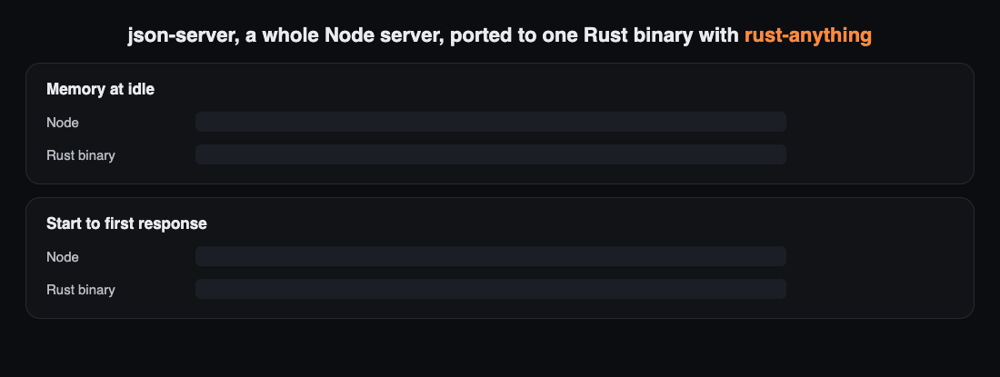

<p align="center">
  
</p>

<h1 align="center">rust-anything</h1>

<p align="center"><sub><a href="../README.md">English</a> · <a href="README_TR.md">Türkçe</a> · <a href="README_UK.md">Українська</a> · <a href="README_ZH.md">简体中文</a> · <a href="README_ZH-TW.md">繁體中文</a> · <a href="README_DE.md">Deutsch</a> · <a href="README_FR.md">Français</a> · <a href="README_RU.md">Русский</a> · <a href="README_JA.md">日本語</a> · <a href="README_KO.md">한국어</a> · <a href="README_AZ.md">Azərbaycanca</a> · <a href="README_UZ.md">Oʻzbekcha</a> · <a href="README_KK.md">Қазақша</a> · <a href="README_KY.md">Кыргызча</a> · Türkmençe · <a href="README_TT.md">Татарча</a> · <a href="README_UG.md">ئۇيغۇرچە</a> · <a href="README_PT.md">Português</a> · <a href="README_VI.md">Tiếng Việt</a> · <a href="README_ES.md">Español</a> · <a href="README_IT.md">Italiano</a></sub></p>
<p align="center"><sub>Bu terjimäni jemgyýetçilik goldaýar, şonuň üçin ol <a href="../README.md">iňlisçe README</a> faýlyndan yzda galyp biler.</sub></p>

<p align="center"><b>Programmaňyzy Rust-da täzeden ýazyň we onuň henizem öňküsi ýaly işleýändigini subut ediň.</b><br>
Ol kody özi terjime etmeýär: Rust-y kodlaýyş agentiňiz (ýa-da siz) ýazýar, rust-anything bolsa ony asyl nusga bilen barlaýar.</p>

<p align="center">
  
  
  <a href="../LICENSE"></a>
  <a href="https://crates.io/crates/rust-anything"></a>
  <a href="https://www.npmjs.com/package/rust-anything"></a>
  <br>
  <a href="https://coderabbit.link/erkamyaman"></a>
  <a href="https://github.com/rust-unofficial/awesome-rust#development-tools"></a>
  <a href="https://github.com/AIshihzong/awesome-reverse-engineer-anything"></a>
  <a href="https://github.com/erkamyaman/rust-anything"></a>
</p>

<p align="center"><a href="https://github.com/erkamyaman/rust-anything/discussions/127"></a></p>

<p align="center"><a href="https://trendshift.io/repositories/363468" target="_blank" rel="noopener noreferrer"></a></p>

<p align="center"><b><a href="#çalt-başlangyç">Çalt başlangyç</a></b> · <a href="https://github.com/erkamyaman/rust-anything/releases">Releases</a> · <a href="#çalt-başlangyç">Claude Code plugin</a> · <a href="https://registry.modelcontextprotocol.io/v0.1/servers?search=rust-anything">MCP Registry</a> · <a href="real-world.md">Hakyky portlar</a> · <a href="faq.md#faq">Köp soralýan soraglar</a><br>
<sub><a href="#diller">Diller</a> · <a href="how-it-works.md#how-it-works">Nähili işleýär</a> · <a href="whole-apps.md#port-a-whole-app">Tutuş programmalar</a> · <a href="../LICENSE">MIT</a></sub><br>
Türkiýede 🇹🇷 <a href="https://github.com/erkamyaman">erKam Yaman</a> tarapyndan döredildi · <a href="../LICENSE">MIT</a> · <a href="https://github.com/sponsors/erkamyaman">❤️ Hemaýatkär boluň</a> · Hemaýatkär: <a href="https://coderabbit.link/erkamyaman"> <b>CodeRabbit</b></a></p>

<p align="center">2.0-da täze: <a href="real-world.md#prettier">Prettier Rust-a geçirildi</a>. 19x has çalt · ýazga alnan 17,224 işletmäniň 15,861-si doly Rust-da · hemmesi baýtma-baýt deň</p>

<p align="center">
  
  <br>
  <sub>ms, Fuse.js we json-server-den alnan 59 hakyky faýlda Prettier we onuň Rust porty (Apple M4). Baýtma-baýt birmeňzeş çykyş. <a href="real-world.md#prettier">Nähili ölçüldi</a>.</sub>
</p>

<p align="center"><sub>PHP we C#: şu gün ýazga almak, gaýtadan işletmek we front door; modul portlary indiki nobatda.</sub></p>

<table>
  <tr>
    <td width="25%" valign="top">
      <b>Ýazga almak</b><br>
      <code>record</code> asyl nusgany döredilen çäk ýagdaýlarynda, semantik duzaklarda we siziň öz girişleriňizde işledýär we onuň näme gaýtarýanyny ýa-da näme taşlaýanyny saklaýar.
    </td>
    <td width="25%" valign="top">
      <b>Geçirmek</b><br>
      <code>bridge</code> Rust crate-ini we wrapper döredýär, şonuň üçin çagyryjylar asyl API-ni saklaýar. Rust koduny siz ýa-da agentiňiz ýazýar.
    </td>
    <td width="25%" valign="top">
      <b>Barlamak</b><br>
      <code>diff</code> ýazga alnan her ýagdaýy Rust-a garşy gaýtadan işledýär we olaryň hemmesi gabat gelýänçä we <code>gate</code> geçýänçä hiç zat çykarylmaýar.
    </td>
    <td width="25%" valign="top">
      <b>Lift</b><br>
      Replay hiç hili fallback bolmazdan geçende we her birlik gate-den geçende, <code>app lift</code> ony arassa Rust programmasyna öwürýär. Asyl nusga hiç haçan üýtgedilmeýär.
    </td>
  </tr>
</table>

**Tutuş programmaňyzy Rust-da bölek-bölekden täzeden ýazyň.** rust-anything siziň Node.js
(TypeScript/JavaScript), Python, C, Go, Ruby ýa-da Java programmaňyzyň häzir näme edýändigini ýazga
alýar, soňra Rust nusgasynyň her bölegini indiki bölege geçmezden öň şol ýazgy bilen deňeşdirip
barlaýar, programma doly arassa Rust bolýança. CLI-ler, HTTP serwerler we kitaphanalar; Rust koduny
siziň kodlaýyş agentiňiz (ýa-da özüňiz) ýazýar. Ol diňe ýazgynyň öz içine alýan zadyny tutup bilýär:
[Onuň tutup bilmeýän zatlary](how-it-works.md#what-it-cant-catch) bölümine serediň. Tutuş gurallar
we serwerler ýa-da diňe haýal bölegi, bir gezekde bir hot path:

| Hakyky taslama, çykyşy asyl nusga bilen birmeňzeş | Asyl nusga | rust-anything bilen |
| --- | ---: | ---: |
| [Prettier](real-world.md#prettier) 3.6.2, buýruk setirinden 2,360 JS/TS faýly | 128.6 s | **6.9 s: 19x has çalt** |
| Prettier, buýruk setirinden 6,305 Markdown faýly | 352 s | **22.5 s: 15.6x has çalt** |
| [json-server](real-world.md#json-server), tutuş bir Node serweri: boş durandaky ýat | 74 MB | **3.5 MB**, ýeke-täk 5.3 MB binar faýl |
| json-server, başlangyçdan ilkinji jogaba çenli | 79 bilen 85 ms aralygy | **8 bilen 10 ms aralygy** |
| 50,000 setirde [Fuse.js](real-world.md#fusejs) gözlegi, bir soraga | 91.2 ms | **2.8 ms: 32x has çalt** |

Prettier: ýazga alnan 17,224 işletmäniň 15,861-si 10 dilde (JavaScript, TypeScript, JSX, JSON,
GraphQL, YAML, Markdown, CSS, SCSS, Less) doly Rust-da formatlanýar we 17,224-üň hemmesi Prettier
bilen baýtma-baýt gabat gelýär, sebäbi entek geçirilmedik islendik zat Prettier-e gaýdýar.
json-server: ýazga alnan 514/514 HTTP ýagdaýy arassa Rust binar faýlynda gabat gelýär. Apple M4-de,
her biri iki gezek işledilip ölçüldi; wagt ölçülmezden öň her çykyş deňeşdirilýär
([jikme-jiklikler](real-world.md)). Her kiçijik funksiýa üçin Rust-y aýratyn çagyrmak adatça JIT-den
*haýalrak*; rust-anything göçürmäge degýän aýlawy tapýar we şony göçürýär.

## Diňe haýal bölegi

Tutuş programmany geçirmegiňiz hökman däl. `go`-ny gaty haýal işleýän buýruga gönükdiriň, ol wagty
alýan ýeke-täk funksiýany geçirer:

```sh
rust-anything go --agent claude -- python3 app.py
```

Ol işletmäni profilleýär, göçürmäge degýän iň daşky funksiýany saýlaýar (içindäki kiçi çagyryşy
däl-de, aýlawy; profil şeýle diýse, batch görnüşinde), ony döredilen girişlerde we siziň işletmäňiziň
edýän çagyryşlarynda ýazga alýar we `src/port.rs` faýlyny agentiňize berýär (`claude`, `codex` ýa-da
stdin-den prompt okaýan islendik buýruk; `--agent` bolmasa, siziň üçin `TASK.md` ýazýar we
saklanýar). Funksiýany diňe ýazga alnan her ýagdaý gabat gelende we `gate` geçende işe goýberýär.
Soňra:

```sh
rust-anything report rust/dedupe-rs     # pull request üçin REPORT.md we card.svg
rust-anything disable rust/dedupe-rs    # baýtma-baýt asyl nusga gaýdyş
```

Ýokardaky [Fuse.js](real-world.md#fusejs) hatary hem şu görnüşde: Fuse-yň bir setir üçin baly tutuş
sanaw boýunça batch görnüşinde Rust-a göçürildi, obýekt açarlary, giňeldilen gözleg we galan zatlar
bolsa JavaScript-de galdy. Netijede 50,000 setirde bir soraga 91.2 ms-den 2.8 ms-e çenli. `go`-ny
20 setirlik Python dedupe bolan [`tests/fixtures/go-fuzzy`](../tests/fixtures/go-fuzzy) üstünde
synap görüň. Porty açmagyň we ýapmagyň ähli ýollary:
[Switch a port on and off](how-it-works.md#switch-a-port-on-and-off).

<p align="center">
  
  <br>
  <sub>Tutuş bir Node serweri bolan json-server arassa Rust binar faýlyna öwrüldi (Apple M4). <a href="real-world.md#json-server">Nähili ölçüldi</a>.</sub>
</p>

> rust-anything garaşsyz taslama, ol Rust Project ýa-da Rust Foundation bilen baglanyşykly däl we
> olar tarapyndan goldanmaýar. "Rust" Rust Foundation-yň söwda belgisidir.

> [!WARNING]
> `record` we `app record` siziň asyl kodyňyzy işledýär, her funksiýany (ýa-da tutuş programmany) köp
> sanly döredilen girişde çagyrýar, `app record` bolsa her ýagdaýy iki gezek işledýär. `diff`, `gate` we
> `app replay` şol ýagdaýlary portda ýa-da asyl nusgada ýene işledýär. Faýl ýazýan, maglumat binasy bilen
> işleýän ýa-da tora ýüz tutýan kod muny her ýagdaý üçin bir gezek edýär. Olary taslamanyň nusgasynda,
> synag maglumat binasy bilen we gurşawda production maglumatlary bolmazdan işlediň.

## Çalt başlangyç

Muny Claude Code, Codex, Cursor, Gemini CLI ýa-da OpenCode içine goýuň we gurnamagy agentiňize tabşyryň:

```text
Install rust-anything: run `cargo install rust-anything`, then `rust-anything setup`.
Tell me when to restart you.
```

Ýa-da özüňiz:

```sh
cargo install rust-anything   # from crates.io
rust-anything setup           # registers it with Claude Code, Codex, Cursor, Gemini CLI and OpenCode
```

Entek Rust toolchain ýokmy? macOS, Linux we Windows üçin taýýar binar faýllar her
[GitHub release](https://github.com/erkamyaman/rust-anything/releases) sahypasyna goşulan, JavaScript
taslamalary üçin bolsa `npm install -g rust-anything` şol bir binar faýly gurnaýar.

Claude Code-da ony plugin hökmünde hem gurnap bilersiňiz (MCP serwer we skill; ýokardaky CLI siziň
`PATH` içiňizde bolmaly):

```text
/plugin install rust-anything --marketplace erkamyaman/rust-anything
```

`setup` tapan her agentine MCP serweri goşýar we workflow skill-ini agentiň skill-leri okaýan ýerine
gurnaýar. Ol beýleki sazlamalaryňyzy saklaýar, ony gaýtadan işletmek howpsuz, `--remove` bolsa ony yzyna
gaýtarýar. Soňra agentiňizden, meselem, şeýle soraň:

- *"Bu CLI-ni rust-anything bilen başdan-aýak Rust-da täzeden ýaz we onuň edil şonuň ýaly işleýändigini subut et."*
- *"Bu gözleg haýal ýaly. Ony rust-anything bilen profille we hot loop-y Rust-a göçür."*
- *"rust-anything bilen `src/parser/` bukjasyny Rust-a geçirmegiň meýilnamasyny düz; birinji birligi geçir we subut et."*
- *"`rust/text-rs` içindäki Rust portuny asyl nusga bilen benchmark arkaly deňeşdir we ony çykarmalymy, aýt."*

### Haýsy agentler bilen işleýär

| Agent | `rust-anything setup` näme goşýar |
| --- | --- |
| Claude Code | `~/.claude.json` içinde MCP serwer, `~/.claude/skills/` içinde skill |
| Codex | `~/.codex/config.toml` içinde MCP serwer, `~/.codex/skills/` içinde skill |
| Cursor | `~/.cursor/mcp.json` içinde MCP serwer |
| Gemini CLI | `~/.gemini/settings.json` içinde MCP serwer |
| OpenCode | `~/.config/opencode/opencode.json` içinde MCP serwer (`mcp.servers`), `~/.config/opencode/skills/` içinde skill |
| Islendik başga MCP müşderi | `rust-anything mcp` buýrugyny stdio serwer hökmünde el bilen goşuň ([Gurnamak](install.md#install) bölümine serediň) |

Bar bolan faýly üýtgetmezden öň `setup` onuň nusgasyny ýanynda saklaýar (`<file>.rust-anything.bak`).

OpenCode-y el bilen birikdirmek üçin serweri `~/.config/opencode/opencode.json` içine goýuň
(`command` tutuş argv) we [`skills/rust-anything/`](../skills/rust-anything) bukjasyny
`~/.config/opencode/skills/rust-anything/` içine göçürip alyň:

```json
{
  "mcp": {
    "servers": {
      "rust-anything": { "type": "local", "command": ["rust-anything", "mcp"] }
    }
  }
}
```

Ýa-da ädimleri özüňiz ýerine ýetiriň:

```sh
rust-anything profile . -- node bench.mjs              # what is hot, and who calls it
rust-anything bridge . src/fuzzy.ts --batch fuzzyScore:text
# write src/port.rs (or let your agent), then:
rust-anything record rust/fuzzy-rs && rust-anything build rust/fuzzy-rs
rust-anything diff rust/fuzzy-rs                       # every recorded case must match
rust-anything bench rust/fuzzy-rs                      # faster? the verdict says
rust-anything gate rust/fuzzy-rs                       # done means this passes
```

rust-anything kody terjime etmeýär: Rust koduny siziň kodlaýyş agentiňiz (Claude Code, Codex, Cursor,
OpenCode, ...) ýa-da özüňiz ýazýarsyňyz. rust-anything agentiň ygtybarly çaklap bilmeýän zatlaryny berýär: wagt
nirä gidýär, ilki näme we haýsy tertipde geçirmeli, galan kodyň Rust-y API-sini üýtgetmezden çagyrmagy
üçin bridge, portuň gabat gelmeli takyk özüni alyp barşy, ony çykarmagyň howpsuz ýoly we portuň haçan
taýýardygyny aýdýan gate.

Birmeňzeş çykyş ýeterlik däl. Programmanyň daşaryk iberýän zatlaryny hem ýazga alyň, şonda haty iki gezek iberýän täze nusga şowsuz bolýar:

<p align="center">
  
  <br>
  <sub><code>app record --effects</code> we <code>app replay</code> buýruklarynyň hakyky işledilişi. <a href="whole-apps.md#side-effects-email-webhooks-and-databases">Gapdal täsirler</a> bölümine serediň.</sub>
</p>

## Diller

| Dil | Birlik | Bridge | Kim ýazga alýar we gaýtadan işledýär |
| --- | --- | --- | --- |
| TypeScript/JavaScript | bukja ýa-da faýl | döredilen binar wire bilen napi-rs ýa-da wasm-bindgen; klaslar we async hem bar | Node, `.ts` çeşme faýllaryny göni işledýär |
| Python | paket ýa-da modul | PyO3 (abi3), göni öwrülişik, tipli exception-lar | Python, asyl nusgany import edýär |
| C | `.c` faýly | asyl atlary we header bilen `extern "C"` funksiýalary | shared library hökmünde kompilirlenen asyl nusga, ctypes arkaly çagyrylýar, her ýagdaý üçin bir fork |
| Go | paket | tipli cgo çagyryşlary we döredilen binar wire, asyl API-li paketde | döredilen Go draýweri, aýratyn modul hökmünde gurulýar |
| Ruby | modul funksiýalaryndan ybarat faýl ýa-da bukja | asyl modullaryň aşagyndaky magnus giňeltmesi | döredilen Ruby draýweri |
| Java | `public static` usullaryndan ybarat paket | tipli JNI we döredilen binar wire, asyl usullary bolan wrapper klaslarynda | döredilen reflection draýweri |
| PHP | funksiýalardan we `public static` usullaryndan ybarat bukja | indiki nobatda: C ABI arkaly PHP FFI | häzir tutuş programmalar: `app record`, `app replay` we front door, CLI-ler we serwerler üçin (`php -S`) |
| C# | `public static` usullaryndan ybarat bukja | indiki nobatda: C ABI arkaly P/Invoke | häzir tutuş programmalar: `app record`, `app replay` we front door, CLI-ler we ASP.NET serwerleri üçin (`dotnet <app>.dll`) |

C-den başga her dil batch klaslaryny hem alýar (`--batch`): elementler serhetden bir gezek geçýär we
Rust-da galýar, her çagyryş bolsa olaryň hemmesini ähli ýadrolarda işleýär.

Dil repozitoriýden kesgitlenýär (`go.mod`, `pom.xml`, `.csproj` ýa-da `.sln`, `pyproject.toml`,
`Gemfile`, `composer.json`, `package.json`, bolmasa iň köp duş gelýän çeşme faýllary boýunça); `--lang`
ony el bilen görkezýär. Tipler çeşme kodundan alynýar: TS tipleri, Python hint-leri, C, Go, Java we C#
signaturalary, Ruby YARD tegleri, PHP tipleri we phpdoc; san hökmünde ulanylýan tipsiz parametrler san
diýlip kabul edilýär.

PHP üçin `analyze` PHP programmasyny meýilleşdirýär (Composer paketleri we PSR-4
autoloading, loose comparison we integer-iň float-a dolup geçmegi ýaly töwekgelçilikler, crate-lere
laýyklaşdyrylan Composer paketleri), PHP CLI-ni ýa-da serwerini bolsa ýazga alyp, gaýtadan işledip we
Rust front door-yň arkasyna goýup bolýar. Onuň birliklerini PHP FFI arkaly Rust-a geçirmek indiki ädim
([issue #2](https://github.com/erkamyaman/rust-anything/issues/2)).

C# hem edil şeýle işleýär: `analyze` `.csproj` taslamalaryny we olaryň NuGet paketlerini
okaýar (crate-lere laýyklaşdyrylýar), `using` direktiwalaryny bukjalara çözýär we C#-yň başgaça
edýän zatlaryny belleýär (`decimal`, `dynamic`, LINQ-iň yza süýşürilen soraglary, `Task`, `lock`,
reflection). C# CLI-ni ýa-da ASP.NET serwerini ýazga alyp, gaýtadan işledip we Rust front door-yň
arkasyna goýup bolýar; birlikleri P/Invoke arkaly geçirmek indiki nobatda.

## Has giňişleýin

- [Nähili işleýär](how-it-works.md): aýlaw, `bridge` we `analyze` näme karar berýär, hot paths, onuň tutup bilmeýän zatlary, hakyky portuň näme talap edýändigi we asyl nusga bilen deň gitmek (`map`)
- [Tutuş programmany geçirmek](whole-apps.md): serwerler, CLI-ler we kitaphanalar, front door-dan `app lift` çenli
- [Mysallar we tejribe mysallary](examples.md): x18n we alty dilde hakyky kod
- [Hakyky portlar](real-world.md): json-server, Fuse.js, vercel/ms, benchmark-lar bilen
- [Gurnamak, täzelemek we işläp düzmek](install.md): gurnamagyň ähli usullary, Windows we çeşme kodundan gurmak
- [Köp soralýan soraglar](faq.md) · [Ýagdaý](STATUS.md) · [MCP gurallary](tools.md)

## Hemaýatkärler

<p align="center">
  <a href="https://github.com/erkamyaman/rust-anything">rust-anything</a> mugt we açyk çeşmeli taslama. Eger ol işiňize kömek edýän bolsa, oňa hemaýatkär bolmagy göz öňünde tutuň.<br>
  Siziň goldawyňyz işläp düzmegiň dowam etmegine kömek edýär.
</p>

<p align="center">
  <a href="https://coderabbit.link/erkamyaman">
    <picture>
      <source media="(prefers-color-scheme: dark)" srcset="assets/sponsors/company-dark.svg">
      
    </picture>
  </a>
</p>

<p align="center">
  <a href="https://github.com/sponsors/erkamyaman">
    <picture>
      <source media="(prefers-color-scheme: dark)" srcset="assets/sponsors/sponsors-dark.svg">
      
    </picture>
  </a>
</p>

<p align="center">
  <a href="https://github.com/sponsors/erkamyaman"></a>
  <a href="https://buymeacoffee.com/erkamyaman"></a>
</p>

## Goşant goşmak

Issue-lar we pull request-ler hoş görülýär; [CONTRIBUTING.md](../CONTRIBUTING.md) gurşawy sazlamagy,
testleriň nirede ýerleşýändigini we täze dili nähili goşmalydygyny düşündirýär. Dizaýn kararlary we
olaryň sebäpleri [DECISIONS.md](../DECISIONS.md) içinde. Hakyky portlaryň tejribe mysallary aýratyn
hoş görülýär. Howpsuzlyk meseleleri barada gizlin habar beriň ([SECURITY.md](../SECURITY.md)), şeýle
hem [özüňi alyp barş kodeksine](../CODE_OF_CONDUCT.md) serediň.

## Ygtyýarnama

[MIT](../LICENSE) © [Erkam Yaman](https://github.com/erkamyaman). Repozitoriýiňizdäki portlar we döredilen kod siziňki.
