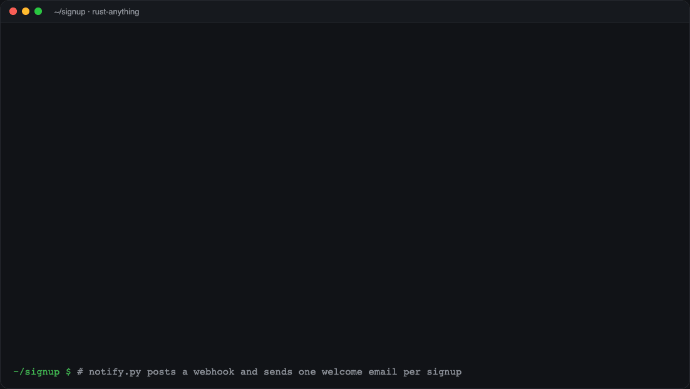

<p align="center">
  
</p>

<h1 align="center">rust-anything</h1>

<p align="center"><b>Ilovangizni Rust'da qayta yozing va u hamon xuddi shunday ishlashini isbotlang.</b></p>

<p align="center">2.0'da yangi: <a href="real-world.md#prettier">Prettier Rust'ga port qilindi</a>. 19x tezroq · 17,224 ta yozib olingan ishga tushirishdan 15,837 tasi to'liq Rust'da · hammasi baytma-bayt bir xil</p>

<p align="center">
  <a href="https://crates.io/crates/rust-anything"></a>
  <a href="https://www.npmjs.com/package/rust-anything"></a>
  <a href="https://github.com/erkamyaman/rust-anything/actions/workflows/ci.yml"></a>
  <a href="https://github.com/erkamyaman/rust-anything"></a>
  <a href="https://github.com/AIshihzong/awesome-reverse-engineer-anything"></a>
</p>

<p align="center">
  <a href="#tezkor-boshlash">Tezkor boshlash</a> ·
  <a href="#tillar">Tillar</a> ·
  <a href="real-world.md">Haqiqiy portlar</a> ·
  <a href="how-it-works.md#how-it-works">Qanday ishlaydi</a> ·
  <a href="whole-apps.md#port-a-whole-app">Butun ilovalar</a> ·
  <a href="faq.md#faq">Ko'p so'raladigan savollar</a>
</p>

<p align="center">Turkiyada 🇹🇷 <a href="https://github.com/erkamyaman">erKam Yaman</a> tomonidan yaratilgan · <a href="../LICENSE">MIT</a> · <a href="https://github.com/sponsors/erkamyaman">❤️ Homiy bo'ling</a></p>

<p align="center">Homiy: <a href="https://coderabbit.ai"> <b>CodeRabbit</b></a></p>

<p align="center"><sub><a href="../README.md">English</a> · <a href="README_TR.md">Türkçe</a> · <a href="README_UK.md">Українська</a> · <a href="README_ZH.md">简体中文</a> · <a href="README_ZH-TW.md">繁體中文</a> · <a href="README_DE.md">Deutsch</a> · <a href="README_FR.md">Français</a> · <a href="README_RU.md">Русский</a> · <a href="README_JA.md">日本語</a> · <a href="README_KO.md">한국어</a> · <a href="README_AZ.md">Azərbaycanca</a> · Oʻzbekcha · <a href="README_KK.md">Қазақша</a> · <a href="README_KY.md">Кыргызча</a> · <a href="README_TK.md">Türkmençe</a> · <a href="README_TT.md">Татарча</a> · <a href="README_UG.md">ئۇيغۇرچە</a> · <a href="README_PT.md">Português</a> · <a href="README_VI.md">Tiếng Việt</a></sub></p>
<p align="center"><sub>Bu tarjima hamjamiyat tomonidan yuritiladi va <a href="../README.md">inglizcha README</a>dan ortda qolishi mumkin.</sub></p>

<table>
  <tr>
    <td width="25%" valign="top">
      <b>Yozib olish</b><br>
      <code>record</code> asl nusxani generatsiya qilingan chegaraviy holatlar, semantik tuzoqlar va o'z kirish ma'lumotlaringiz ustida ishga tushiradi hamda u nima qaytarishi yoki qanday xato tashlashini saqlaydi.
    </td>
    <td width="25%" valign="top">
      <b>Port</b><br>
      <code>bridge</code> Rust crate'ini va wrapper'ni generatsiya qiladi, shunda chaqiruvchilar asl API'ni saqlab qoladi. Rust kodini siz yoki agentingiz yozadi.
    </td>
    <td width="25%" valign="top">
      <b>Tekshirish</b><br>
      <code>diff</code> har bir yozib olingan holatni Rust'ga qarshi qayta ijro etadi va ularning hammasi mos kelmaguncha hamda <code>gate</code> o'tmaguncha hech narsa chiqarilmaydi.
    </td>
    <td width="25%" valign="top">
      <b>Lift</b><br>
      Qayta ijro fallback'siz o'tganda va har bir birlik gate'dan o'tganda, <code>app lift</code> uni toza Rust ilovasiga aylantiradi. Asl nusxaga hech qachon tegilmaydi.
    </td>
  </tr>
</table>

**Butun ilovangizni Rust'da, qismma-qism qayta yozing.** rust-anything Node.js
(TypeScript/JavaScript), Python, C, Go, Ruby yoki Java ilovangiz bugun nima qilayotganini yozib oladi,
so'ng Rust'da qayta yozilgan har bir qismni keyingisiga o'tishdan oldin shu yozuv bilan tekshiradi,
toki ilova to'liq Rust bo'lguncha. CLI'lar, HTTP serverlar va kutubxonalar; Rust kodini kodlash
agentingiz (yoki o'zingiz) yozadi. U faqat yozuv qamrab olgan narsani ushlay oladi:
[Nimalarni aniqlay olmaydi](how-it-works.md#what-it-cant-catch) bo'limiga qarang. Butun vositalar
va serverlar yoki faqat sekin qism, bir vaqtda bitta hot path'dan:

| Haqiqiy loyiha, asl nusxa bilan bir xil natija | Asl nusxa | rust-anything bilan |
| --- | ---: | ---: |
| [Prettier](real-world.md#prettier) 3.6.2, buyruq qatoridan 2,360 ta JS/TS fayl | 128.6 s | **6.9 s: 19x tezroq** |
| Prettier, buyruq qatoridan 6,305 ta Markdown fayl | 352 s | **22.5 s: 15.6x tezroq** |
| [json-server](real-world.md#json-server), butun bir Node server: bo'sh turgandagi xotira | 74 MB | **3.5 MB**, bitta 5.3 MB binary |
| json-server, ishga tushishdan birinchi javobgacha | 79 dan 85 ms gacha | **8 dan 10 ms gacha** |
| 50,000 string ustida [Fuse.js](real-world.md#fusejs) qidiruvi, har so'rovga | 91.2 ms | **2.8 ms: 32x tezroq** |

Prettier: 17,224 ta yozib olingan ishga tushirishdan 15,837 tasi 10 tilda (JavaScript, TypeScript,
JSX, JSON, GraphQL, YAML, Markdown, CSS, SCSS, Less) to'liq Rust'da formatlanadi va 17,224 tasining
hammasi Prettier bilan baytma-bayt mos keladi, chunki hali port qilinmagan har qanday narsa
Prettier'ga qaytadi. json-server: yozib olingan 514/514 HTTP holat toza Rust binary'sida mos keladi.
Apple M4 da, har biri ikki marta ishga tushirilib o'lchangan; vaqt o'lchanishidan oldin har bir
natija solishtiriladi ([batafsil](real-world.md)). Har bir kichik funksiya uchun Rust'ni alohida
chaqirish odatda JIT'dan *sekinroq*; rust-anything ko'chirishga arziydigan siklni topadi va uni ko'chiradi.

<p align="center">
  
  <br>
  <sub>ms, Fuse.js va json-server'dan olingan 59 ta haqiqiy faylda Prettier uning Rust portiga qarshi (Apple M4). Baytma-bayt bir xil natija. <a href="real-world.md#prettier">Qanday o'lchangan</a>.</sub>
</p>

<p align="center">
  
  <br>
  <sub>Butun bir Node server bo'lgan json-server toza Rust binary'siga aylantirildi (Apple M4). <a href="real-world.md#json-server">Qanday o'lchangan</a>.</sub>
</p>

> rust-anything mustaqil loyiha bo'lib, Rust Project yoki Rust Foundation bilan bog'liq emas va ular
> tomonidan qo'llab-quvvatlanmaydi. "Rust" Rust Foundation'ning savdo belgisidir.

> [!WARNING]
> `record` va `app record` asl kodingizni ishga tushiradi, har bir funksiyani (yoki butun ilovani)
> ko'plab generatsiya qilingan kirish ma'lumotlari bilan chaqiradi, `app record` esa har bir holatni ikki marta
> ishga tushiradi. `diff`, `gate` va `app replay` xuddi shu holatlarni port yoki asl nusxada yana ishga tushiradi.
> Fayl yozadigan, ma'lumotlar bazasiga murojaat qiladigan yoki tarmoqqa chiqadigan kod buni har bir holat uchun
> bir marta qiladi. Ularni loyihaning nusxasida, test ma'lumotlar bazasi bilan va muhitda production hisob
> ma'lumotlarisiz ishga tushiring.

## Tezkor boshlash

Buni Claude Code, Codex, Cursor, Gemini CLI yoki OpenCode'ga joylashtiring va o'rnatishni agentingizga topshiring:

```text
rust-anything'ni o'rnat: `cargo install rust-anything`, so'ng `rust-anything setup` ni ishga tushir.
Seni qachon qayta ishga tushirishim kerakligini ayt.
```

Yoki o'zingiz:

```sh
cargo install rust-anything   # crates.io'dan
rust-anything setup           # uni Claude Code, Codex, Cursor, Gemini CLI va OpenCode'da ro'yxatdan o'tkazadi
```

Hali Rust toolchain'ingiz yo'qmi? macOS, Linux va Windows uchun tayyor binary fayllar har bir
[GitHub release](https://github.com/erkamyaman/rust-anything/releases)'ga biriktirilgan, JavaScript
loyihalari uchun esa `npm install -g rust-anything` xuddi shu binary'ni o'rnatadi.

Claude Code'da uni plugin sifatida ham o'rnatishingiz mumkin (MCP server va skill; yuqoridagi CLI
`PATH` ichida bo'lishi kerak):

```text
/plugin install rust-anything --marketplace erkamyaman/rust-anything
```

`setup` topgan har bir agentiga MCP serverni qo'shadi va workflow skill'ini agent skill'larni o'qiydigan
joyga o'rnatadi. U boshqa sozlamalaringizni saqlaydi, qayta ishga tushirish xavfsiz, `--remove` esa
qilganlarini bekor qiladi. So'ng agentingizdan, masalan, quyidagilarni so'rang:

- *"Bu CLI'ni rust-anything bilan boshidan oxirigacha Rust'da qayta yoz va u xuddi shunday ishlashini isbotla."*
- *"Bu qidiruv sekin tuyulyapti. rust-anything bilan profilini ol va issiq siklni Rust'ga ko'chir."*
- *"`src/parser/` ni rust-anything bilan Rust'ga ko'chirishni rejalashtir; birinchi birlikni port qil va isbotla."*
- *"`rust/text-rs` dagi Rust portini asl nusxaga qarshi benchmark qil va uni chiqarish kerakmi, ayt."*

### Qo'llab-quvvatlanadigan agentlar

| Agent | `rust-anything setup` qo'shadi |
| --- | --- |
| Claude Code | `~/.claude.json` da MCP server, `~/.claude/skills/` da skill |
| Codex | `~/.codex/config.toml` da MCP server, `~/.codex/skills/` da skill |
| Cursor | `~/.cursor/mcp.json` da MCP server |
| Gemini CLI | `~/.gemini/settings.json` da MCP server |
| OpenCode | `~/.config/opencode/opencode.json` da MCP server (`mcp.servers`), `~/.config/opencode/skills/` da skill |
| Istalgan boshqa MCP mijozi | `rust-anything mcp` ni qo'lda stdio server sifatida qo'shing ([O'rnatish](install.md#install) ga qarang) |

Mavjud faylni o'zgartirishdan oldin `setup` uning yoniga nusxasini saqlaydi (`<file>.rust-anything.bak`).

OpenCode'ni qo'lda ulash uchun serverni `~/.config/opencode/opencode.json` ga qo'ying (`command`
butun argv) va [`skills/rust-anything/`](../skills/rust-anything) papkasini
`~/.config/opencode/skills/rust-anything/` ga nusxalang:

```json
{
  "mcp": {
    "servers": {
      "rust-anything": { "type": "local", "command": ["rust-anything", "mcp"] }
    }
  }
}
```

Yoki qadamlarni o'zingiz bajaring:

```sh
rust-anything profile . -- node bench.mjs              # nima issiq va uni kim chaqiradi
rust-anything bridge . src/fuzzy.ts --batch fuzzyScore:text
# src/port.rs ni yozing (yoki agentingizga yozdiring), so'ng:
rust-anything record rust/fuzzy-rs && rust-anything build rust/fuzzy-rs
rust-anything diff rust/fuzzy-rs                       # har bir yozib olingan holat mos kelishi kerak
rust-anything bench rust/fuzzy-rs                      # tezroqmi? hukm aytadi
rust-anything gate rust/fuzzy-rs                       # tayyor degani, bu o'tadi degani
```

rust-anything kodni tarjima qilmaydi: Rust'ni kodlash agentingiz (Claude Code, Codex, Cursor, OpenCode, ...)
yoki o'zingiz yozasiz. rust-anything agent ishonchli taxmin qila olmaydigan narsalarni beradi: vaqt
qayerga ketayotganini, avval nimani va qanday tartibda port qilishni, kodning qolgan qismi Rust'ni
API'si o'zgarmagan holda chaqirishi uchun ko'prikni (bridge), port mos kelishi shart bo'lgan aniq
xatti-harakatni, uni chiqarishning xavfsiz yo'lini va port qachon tayyor ekanini aytadigan gate'ni.

Bir xil natija yetarli emas. Ilova tashqariga yuboradigan narsalarni ham yozib oling, shunda xatni ikki marta yuboradigan qayta yozilgan versiya muvaffaqiyatsiz bo'ladi:

<p align="center">
  
  <br>
  <sub><code>app record --effects</code> va <code>app replay</code>ning haqiqiy ishga tushirilishi. <a href="whole-apps.md#side-effects-email-webhooks-and-databases">Yon ta'sirlar</a> bo'limiga qarang.</sub>
</p>

## Tillar

| Til | Birlik | Ko'prik | Yozib oluvchi va qayta ijro etuvchi |
| --- | --- | --- | --- |
| TypeScript/JavaScript | papka yoki fayl | generatsiya qilingan binary wire bilan napi-rs yoki wasm-bindgen; klasslar va async ham | `.ts` manbalarini ishga tushiradigan Node |
| Python | paket yoki modul | PyO3 (abi3), to'g'ridan-to'g'ri konvertatsiya, tiplangan exception'lar | asl nusxani import qiladigan Python |
| C | `.c` fayl | asl nomlar bilan `extern "C"` funksiyalar va header | umumiy kutubxona sifatida kompilyatsiya qilingan asl nusxa, ctypes orqali chaqiriladi, har bir holat uchun bitta fork |
| Go | paket | asl API'li paketda tiplangan cgo chaqiruvlari va generatsiya qilingan binary wire | o'z moduli sifatida build qilinadigan generatsiya qilingan Go drayveri |
| Ruby | modul funksiyalaridan iborat fayl yoki papka | asl modullar ostida magnus kengaytmasi | generatsiya qilingan Ruby drayveri |
| Java | `public static` metodlardan iborat paket | asl metodlarga ega wrapper klasslarda tiplangan JNI va generatsiya qilingan binary wire | generatsiya qilingan reflection drayveri |
| PHP | funksiyalar va `public static` metodlardan iborat papka | navbatda: C ABI orqali PHP FFI | bugun butun ilovalar: CLI'lar va serverlar (`php -S`) uchun `app record`, `app replay` va front door |
| C# | `public static` metodlardan iborat papka | navbatda: C ABI orqali P/Invoke | bugun butun ilovalar: CLI'lar va ASP.NET serverlari (`dotnet <app>.dll`) uchun `app record`, `app replay` va front door |

C'dan tashqari har bir til batch klasslarini ham oladi (`--batch`): elementlar ko'prikdan bir marta
o'tadi va Rust'da qoladi, har bir chaqiruv esa barcha yadrolarda ularning hammasi ustida ishlaydi.

Til repozitoriydan aniqlanadi (`go.mod`, `pom.xml`, `.csproj` yoki `.sln`, `pyproject.toml`,
`Gemfile`, `composer.json`, `package.json`, aks holda eng ko'p uchraydigan manba fayllari); `--lang`
buni almashtiradi. Tiplar manbadan olinadi: TS tiplari, Python type hint'lari, C, Go, Java va C#
signaturalari, Ruby YARD teglari, PHP tiplari va phpdoc; son sifatida ishlatilgan tipsiz parametrlar
son deb aniqlanadi.

PHP uchun `analyze` PHP ilovasini rejalashtiradi (Composer paketlari va PSR-4 autoloading,
erkin taqqoslash va butun sonning float'ga to'lib o'tishi kabi xavflar, crate'larga moslangan Composer
paketlari), PHP CLI yoki serverini esa yozib olish, qayta ijro etish va Rust front door'i ortiga qo'yish
mumkin. Uning birliklarini PHP FFI orqali Rust'ga port qilish keyingi qadam
([issue #2](https://github.com/erkamyaman/rust-anything/issues/2)).

C# ham xuddi shunday ishlaydi: `analyze` `.csproj` loyihalarini va ularning NuGet paketlarini
o'qiydi (crate'larga moslangan), `using` direktivalarini papkalarga bog'laydi va C# boshqacha
qiladigan narsalarni belgilaydi (`decimal`, `dynamic`, LINQ'ning kechiktirilgan so'rovlari, `Task`,
`lock`, reflection). C# CLI yoki ASP.NET serverini yozib olish, qayta ijro etish va Rust front door'i
ortiga qo'yish mumkin; birliklarni P/Invoke orqali port qilish navbatda.

## Batafsil

- [Qanday ishlaydi](how-it-works.md): sikl, `bridge` va `analyze` nimani hal qiladi, hot path'lar, u nimalarni aniqlay olmaydi, haqiqiy port nimalarni talab qiladi va asl nusxa bilan hamqadam bo'lish (`map`)
- [Butun ilovani port qilish](whole-apps.md): serverlar, CLI'lar va kutubxonalar, front door'dan `app lift` gacha
- [Misollar va amaliy tadqiqotlar](examples.md): x18n va olti tildagi haqiqiy kod
- [Haqiqiy portlar](real-world.md): json-server, Fuse.js, vercel/ms, benchmark'lar bilan
- [O'rnatish, yangilash va ishlab chiqish](install.md): barcha o'rnatish usullari, Windows va manba kodidan build qilish
- [Ko'p so'raladigan savollar](faq.md) · [Holat](STATUS.md) · [MCP vositalari](tools.md)

## Homiylar

<p align="center">
  <a href="https://github.com/erkamyaman/rust-anything">rust-anything</a> bepul va ochiq manbali. Agar u ishingizga yordam bersa, iltimos, unga homiylik qilishni o'ylab ko'ring.<br>
  Qo'llab-quvvatlashingiz ishlab chiqishni davom ettirishga yordam beradi.
</p>

<p align="center">
  <a href="https://coderabbit.ai">
    <picture>
      <source media="(prefers-color-scheme: dark)" srcset="assets/sponsors/company-dark.svg">
      
    </picture>
  </a>
</p>

<p align="center">
  <a href="https://github.com/sponsors/erkamyaman">
    <picture>
      <source media="(prefers-color-scheme: dark)" srcset="assets/sponsors/sponsors-dark.svg">
      
    </picture>
  </a>
</p>

<p align="center">
  <a href="https://github.com/sponsors/erkamyaman"></a>
</p>

## Hissa qo'shish

Issue'lar va pull request'lar mamnuniyat bilan qabul qilinadi; [CONTRIBUTING.md](../CONTRIBUTING.md)
sozlash, testlar qayerga joylashishi va yangi til qanday qo'shilishini tushuntiradi. Dizayn qarorlari va
ularning sabablari [DECISIONS.md](../DECISIONS.md) da. Haqiqiy portlar bo'yicha amaliy misollar ayniqsa
mamnuniyat bilan qabul qilinadi. Xavfsizlik muammolari haqida iltimos maxfiy xabar bering
([SECURITY.md](../SECURITY.md)) va [xulq-atvor kodeksi](../CODE_OF_CONDUCT.md) bilan tanishing.

## Litsenziya

[MIT](../LICENSE) © [Erkam Yaman](https://github.com/erkamyaman). Repozitoriyingizdagi portlar va generatsiya qilingan kod sizniki.
